## The question

A site that sells movie tickets also publishes movie ratings. This project examines the **accuracy and possible bias** of those ratings by comparing them with independent aggregators.

## What is inside

- The seller's scraped ratings ([`fandango_scrape.csv`](fandango_scrape.csv)) against scores from other review sites ([`all_sites_scores.csv`](all_sites_scores.csv))
- Data visualisation of the distributions and their differences
- Score **normalisation** with scikit-learn so different rating scales compare fairly

## Finding

After normalising every site to the same 0-5 scale, the seller's distribution is clearly uneven and sits well above the others, while Rotten Tomatoes critics have the most uniform distribution. The seller also **displays a rounded-up version** of its own underlying rating. Among the films critics rated worst, the seller still shows **around four stars**.

## Run it

1. Download `spec-file.txt`.
2. Follow the instructions in `Conda_Virtual_Env.txt`:

```bash
# a new environment from the spec file
conda create --name myenv --file spec-file.txt
# or install the listed packages into an existing environment
conda install --name myenv --file spec-file.txt
```
The full set of environment commands is in [`Conda_Virtual_Env.txt`](Conda_Virtual_Env.txt).

Then open [`Data-Analysis-Project.ipynb`](Data-Analysis-Project.ipynb).

## Built with

`Python` · `NumPy` · `pandas` · `Matplotlib` · `Seaborn` · `scikit-learn`

<br>

<p align="center"><sub>Part of the work of <a href="https://github.com/johnnyk1090">John Konteas</a> · end-to-end data science</sub></p>
